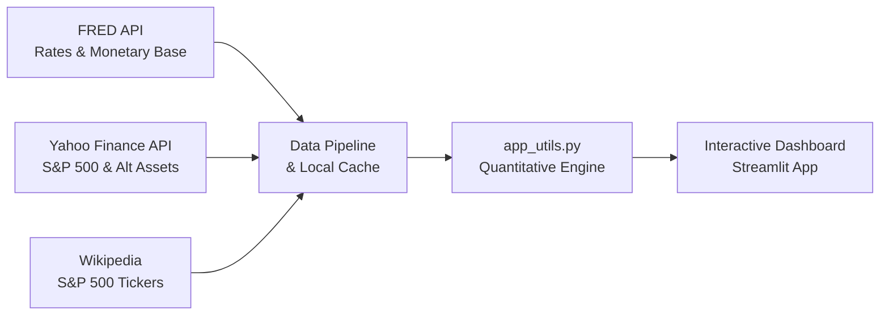

# 📊 Macroeconomic Data Analytics & Portfolio Optimization

<div align="center">


</div>


Un proyecto de **Data Analytics** y **Visualización Financiera** avanzado que estudia el impacto de la política monetaria de la Reserva Federal (FED) en el mercado accionario estadounidense (S&P 500) y diseña una **cartera de inversión diversificada y automatizada** con baja exposición a las decisiones del banco central.

> 💼 **Orientación a Portfolio Profesional:** Este proyecto demuestra habilidades de extremo a extremo en la ingeniería de datos (APIs de FRED y Yahoo Finance), análisis cuantitativo de series temporales, diseño UX/UI interactivo en Streamlit y formulación de estrategias financieras basadas en datos reales.

---

## 📈 Flujo de la Aplicación y Datos

La aplicación se ejecuta de forma interactiva e incluye un dashboard financiero completo de tema oscuro (Dark Mode) con indicadores de rendimiento y matrices de correlación dinámicas.



---

## 🎯 El Problema de Negocio

> **¿Cómo afectan el costo del dinero (tasas FED) y la liquidez (base monetaria) a los mercados de renta variable? ¿Es posible construir una cartera diversificada que mitigue el "riesgo de banco central" sin sacrificar el crecimiento?**

Para dar respuesta a estas preguntas, el análisis integra y procesa de forma continua dos variables macroeconómicas fundamentales:
* **Federal Funds Effective Rate (`FEDFUNDS`)**: Representa el costo del capital en la economía.
* **Monetary Base (`BOGMBASE`)**: Mide el volumen de emisión y la liquidez inyectada en el sistema.

---

## 🚀 Funcionalidades Clave del Dashboard

### 1. 🔍 Análisis Macro & Exploración de Series
* **Visualizaciones Interactivas**: Comparación temporal y correlación del S&P 500 contra la expansión/contracción de la base monetaria y las alzas de tasa.
* **Análisis de Rezagos (Lag Analysis)**: Evaluación cuantitativa de si los cambios en la política monetaria anticipan (rezago) o acompañan (sincronía) los movimientos del mercado.

### 2. 📊 Segmentación de Regímenes Monetarios
* Clasificación dinámica del mercado en función de si la FED se encuentra en un entorno de **Tasas Bajas, Medias o Altas**, o en periodos de **Expansión (QE)** o **Contracción (QT)** de balance, identificando patrones de retorno promedio y volatilidad para cada régimen.

### 3. 💼 Cartera de Inversión Anti-FED Optimizada
* **Grilla de Inversión Premium**: Visualización moderna e interactiva de una cartera diversificada de 12 activos (acciones, commodities, Bitcoin) mediante un panel de tarjetas oscuras.
* **Cálculo de Exposición Dinámica**: Obtención en tiempo real de los coeficientes de correlación absoluta de cada activo y del rendimiento acumulado de la cartera.
* **Comparativa vs. Benchmark**: Gráficos de Plotly de crecimiento acumulativo de $1 y análisis de Drawdown para contrastar la cartera recomendada contra el S&P 500 tradicional.

---

## 🛠️ Stack Tecnológico & Arquitectura

* **Lenguaje:** Python 3.9+
* **Procesamiento de Datos:** Pandas, NumPy
* **Visualización Dinámica:** Plotly (Express & Graph Objects)
* **Frontend e Interfaz:** Streamlit (v1.30+ con soporte HTML5 y CSS3 personalizado)
* **Adquisición de Datos:** `yfinance` (Yahoo Finance API), `fredapi` (FRED Federal Reserve API), `requests` + `beautifulsoup4` (Scraping de Wikipedia).
* **Caching:** Cache en disco (`.data_cache/` con expiración de 24h) y `@st.cache_data` en memoria de Streamlit para optimizar la velocidad y evitar límites de cuotas de las APIs.

---

## 📁 Estructura del Repositorio

```text
.
├── Introducción_ℹ️.py          # Página de inicio del Dashboard
├── app_utils.py                 # Motor analítico y visualizaciones (Plotly)
├── data_fetcher.py              # Pipeline de extracción automatizada de datos
├── requirements.txt             # Dependencias del proyecto
├── EDA.ipynb                    # Notebook de Análisis Exploratorio de Datos
├── pages/                       # Secciones del Dashboard interactivo
│   ├── 01_Visualizaciones_📊🔎.py
│   ├── 02_Conclusiones_macro_📈.py
│   └── 03_Portfolio_recomendado_💼.py
└── .streamlit/
    ├── secrets.toml             # Credenciales locales de FRED (excluido en git)
    └── secrets.toml.example     # Plantilla de configuración de credenciales
```

---

## ⚙️ Configuración e Instalación Local

### 1. Obtener la FRED API Key
Regístrate y solicita una API key gratuita en [FRED API Keys](https://fred.stlouisfed.org/docs/api/api_key.html).

### 2. Configurar las Credenciales
Crea un archivo llamado `.streamlit/secrets.toml` en la raíz del proyecto:
```toml
FRED_API_KEY = "tu_api_key_aqui"
```

### 3. Instalación de Dependencias e Inicio
**En MacOS / Linux:**
```bash
# Crear entorno virtual
python -m venv .venv
source .venv/bin/activate

# Instalar requerimientos
pip install -r requirements.txt

# Ejecutar aplicación
python -m streamlit run Introducción_ℹ️.py
```

**En Windows (PowerShell):**
```powershell
# Crear entorno virtual
python -m venv .venv
.\.venv\Scripts\Activate.ps1

# Instalar requerimientos
pip install -r requirements.txt

# Ejecutar aplicación
python -m streamlit run Introducción_ℹ️.py
```

> ℹ️ **Nota sobre la carga inicial:** La primera vez que abras el dashboard, el pipeline descargará los datos históricos de más de 500 activos desde el año 2015. Esto puede demorar de 1 a 2 minutos. Luego de este paso, la caché local de 24 horas asegura cargas instantáneas.

---

## 🧠 Consideraciones Metodológicas & Limitaciones

* **Correlación vs. Causalidad:** La fuerte correlación contemporánea entre la liquidez de la FED y la renta variable es descriptiva; no implica una causalidad directa univariada, existiendo variables omitidas (PIB, utilidades corporativas, inflación).
* **Datos Históricos:** El análisis de correlación y rezagos se calcula en base a datos de mercado pasados y los comportamientos podrían cambiar en futuros regímenes monetarios inéditos.
* **Descargo de Responsabilidad:** Este dashboard ha sido desarrollado únicamente con fines analíticos y académicos para demostrar habilidades de análisis de datos, y **no representa asesoría financiera** de ningún tipo.
